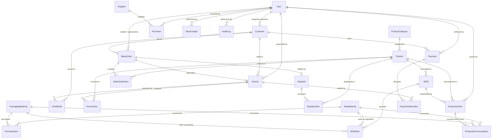

# FactoryFlow – Architectural Design & Technical Specification

> **Technical Architecture, Data Models, Calculation Formulas, and Transactional Safety Mechanisms.**  
> *Author: Senior Full-Stack Software Architect, NIT Tiruchirappalli Internship Evaluation.*

---

## 1. System Architecture Overview

FactoryFlow is built upon a **Modular Layered Architecture** separating presentation, business domain logic, transactional orchestration, and persistent storage:

```
[ Frontend: React + Vite + TypeScript (Single-Page App) ]
                     │  HTTP / REST (JWT Bearer)
                     ▼
[ API Routing & Role Authorization Middleware (Express.js) ]
                     │
                     ▼
[ Domain Services: BOM, Production, Inventory, Invoicing, Costing ]
                     │
                     ▼
[ Transactional Layer (Prisma ORM with ACID Transactions) ]
                     │
                     ▼
[ PostgreSQL Database (Normalized Schema, Constraints, Indexes) ]
```

---

## 2. Entity-Relationship (ER) Diagram



---

## 3. Immutable Stock Ledger Design

### The Core Problem with Naive Inventory Systems
Traditional inventory tables update a single `quantity` column directly in place (`UPDATE products SET stock = stock - 10`). This fails all accounting audits because:
1. Past inventory states cannot be reconstructed.
2. Concurrent operations overwrite each other (lost update anomalies).
3. The root cause of shortages cannot be traced back to purchase orders or dispatches.

### FactoryFlow Solution: Append-Only Immutable Stock Ledger
In FactoryFlow, stock balances are **never directly overwritten**. Every physical change in inventory creates an append-only row in `StockLedger`:

```prisma
model StockLedger {
  id            String            @id @default(uuid())
  itemType      ItemType          // RAW_MATERIAL | PACKAGING | FINISHED_GOOD
  itemId        String            // Foreign key to item table
  movementType  StockMovementType // OPENING_BALANCE, PURCHASE_RECEIPT, PRODUCTION_ISSUE,
                                  // PRODUCTION_OUTPUT, DISPATCH, STOCK_ADJUSTMENT
  quantity      Decimal           @db.Decimal(12, 3) // Positive for additions, negative for deductions
  balanceAfter  Decimal           @db.Decimal(12, 3) // Reconciled balance post-operation
  unit          String
  referenceType String            // "PURCHASE", "PRODUCTION_RUN", "DISPATCH"
  referenceId   String?           // e.g. "PR-2026-0001", "PO-2026-0001", "DSP-2026-0001"
  userId        String?
  createdAt     DateTime          @default(now())
}
```

#### Reconciled Current Stock Query
The current balance of any item is calculated transactionally from the most recent balance entry:
```sql
SELECT "balanceAfter" FROM "StockLedger"
WHERE "itemType" = :itemType AND "itemId" = :itemId
ORDER BY "createdAt" DESC LIMIT 1;
```
If no ledger entries exist, the balance defaults to the opening stock audited at initialization.

---

## 4. Bill of Materials (BOM) & Production Variance

### Batch Multiplier Formula
A BOM defines the standard consumption recipe for a fixed reference batch size (e.g., 200 packets). When a production run specifies a planned batch quantity $Q_{planned}$, the multiplier $M$ scales all recipe requirements:

$$M = \frac{Q_{planned}}{\text{BOM.batchSize}}$$

$$\text{Planned Consumption}_i = \text{BOMItem}_i.\text{standardQuantity} \times M$$

$$\text{Expected Output} = \text{BOM.expectedYield} \times M$$

### Variance Calculations & The 3% Tolerance Rule
Variance indicates operational inefficiency, raw material leakage, or moisture/frying loss:

1. **Consumption Variance %**:
   $$\text{Variance}_{\text{consumption}} = \left( \frac{\text{Actual Consumed} - \text{Planned Consumed}}{\text{Planned Consumed}} \right) \times 100$$

2. **Yield Variance %**:
   $$\text{Variance}_{\text{yield}} = \left( \frac{\text{Actual Good Output} - \text{Expected Output}}{\text{Expected Output}} \right) \times 100$$

3. **Tolerance Alert Rule**:
   $$\text{Status} = \begin{cases} 
   \text{EXCEEDS\_TOLERANCE}, & \text{if } |\text{Variance}| > 3.0\% \\
   \text{NORMAL}, & \text{otherwise}
   \end{cases}$$

In the benchmark scenario:
- Oil planned = 10.0 L, actual = 10.5 L $\implies ((10.5 - 10) / 10) \times 100 = \mathbf{+5\%}$ (Flagged `EXCEEDS_TOLERANCE`).
- Good output planned = 200 pkts, actual = 188 pkts $\implies ((188 - 200) / 200) \times 100 = \mathbf{-6\%}$ (Flagged `EXCEEDS_TOLERANCE`).

---

## 5. Strict FIFO Inventory Valuation & Packet Costing

### Layer Depletion Algorithm
Raw materials purchased at different dates and rates form distinct valuation layers in `InventoryValuationLayer`:
1. When raw material is issued to a batch, the system queries available layers ordered by `receivedDate ASC`.
2. The oldest layer is depleted first. If the needed quantity exceeds the layer's remaining quantity, that layer is reduced to zero and the remainder is consumed from the subsequent layer.

### Cost Breakdown & Overhead Allocation
In packaged food manufacturing, overheads (frying oil gas/power and kitchen wages) must be allocated over **actual good packets produced**, not damaged packets or theoretical planned amounts.

$$\text{Total Production Cost} = \text{Raw Material Cost} + \text{Packaging Cost} + \text{Labour} + \text{Power/Gas}$$

$$\text{Cost per Packet} = \frac{\text{Total Production Cost}}{\text{Actual Good Packets Produced}}$$

$$\text{Gross Margin per Packet} = \text{Selling Price (Excl. Tax)} - \text{Cost per Packet}$$

$$\text{Margin \%} = \left( \frac{\text{Gross Margin per Packet}}{\text{Selling Price (Excl. Tax)}} \right) \times 100$$

In the benchmark:
- 40 kg flour consumed from opening ₹42 layer: $40 \times 42 = \text{₹}1,680$.
- 10.5 L oil consumed from opening ₹140 layer: $10.5 \times 140 = \text{₹}1,470$.
- 1.2 kg spice mix consumed from opening ₹200 layer: $1.2 \times 200 = \text{₹}240$.
- Total Raw Materials = ₹3,390.
- Packaging: 194 pouches @ ₹2.50 = ₹485; 9 cartons @ ₹15 = ₹135 $\implies$ Packaging = ₹620.
- Overheads: Labour = ₹1,200; Gas/Power = ₹600 $\implies$ Overheads = ₹1,800.
- $\text{Total Production Cost} = 3390 + 620 + 1800 = \mathbf{\text{₹}5,810}$.
- $\text{Cost per Packet} = \text{₹}5,810 / 188 = \mathbf{\text{₹}30.904... \approx \text{₹}30.90}$.
- Selling Price = ₹50.00 $\implies$ Margin = ₹19.10 (**38.20%**).

---

## 6. Statutory GST Rules & Calculations

### Place of Supply & Tax Types
FactoryFlow's manufacturing unit is situated in **Tamil Nadu (State Code 33)**:
1. **Intra-State Supplies** (Customer in Tamil Nadu, Code 33):
   $$\text{CGST} = \text{Taxable Value} \times \frac{\text{GST Rate}}{2}$$
   $$\text{SGST} = \text{Taxable Value} \times \frac{\text{GST Rate}}{2}$$
   $$\text{IGST} = 0$$
   *For 5% GST on ₹7,500 taxable: CGST = ₹187.50 (2.5%), SGST = ₹187.50 (2.5%).*

2. **Inter-State Supplies** (Customer outside Tamil Nadu, e.g., Karnataka Code 29):
   $$\text{CGST} = 0, \quad \text{SGST} = 0$$
   $$\text{IGST} = \text{Taxable Value} \times \text{GST Rate}$$
   *For 5% GST on ₹7,500 taxable: IGST = ₹375.00 (5.0%).*

---

## 7. Transaction Safety, Concurrency & Shortage Prevention

### Multi-Table ACID Transactions
Production posting and Dispatch operations touch multiple tables simultaneously. FactoryFlow wraps these in `prisma.$transaction`:
- If an order requests 120 packets when only 88 are available in finished goods stock, the system detects a **32-packet shortage** and aborts the dispatch transaction with an HTTP 400 error.
- Stock is never reduced prematurely upon order submission or approval; stock is exclusively deducted at the exact instant the **Dispatch** record is committed.
- Any failure during production posting rolls back all ledger deductions and layer updates, ensuring zero database corruption or phantom inventory.
